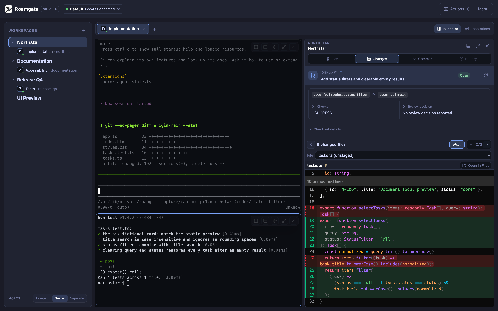
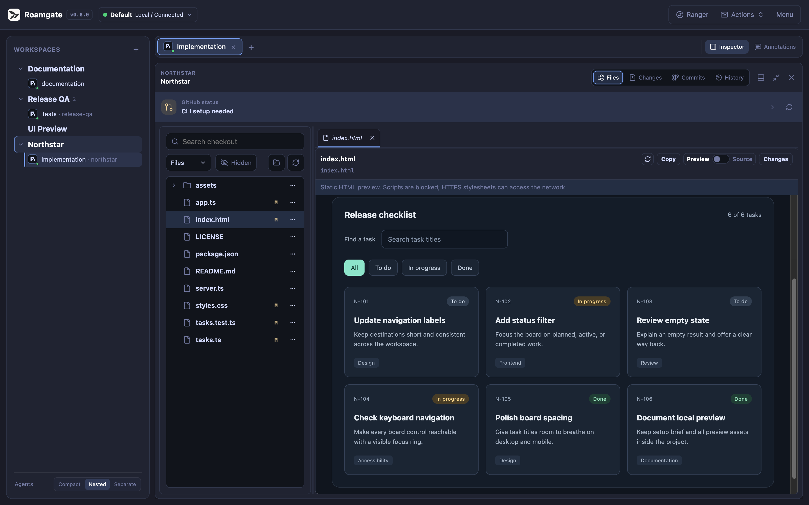
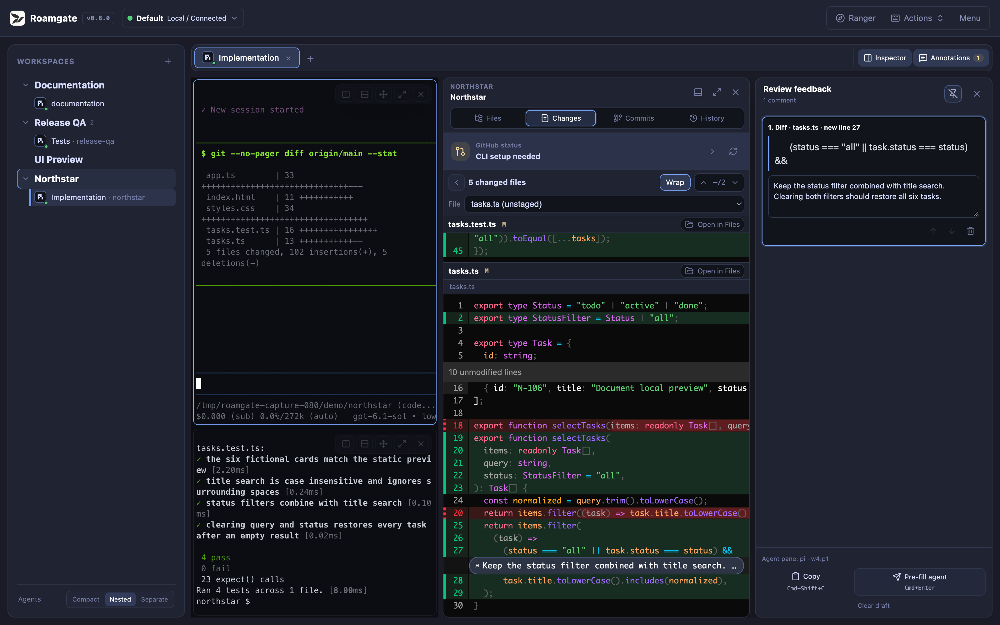
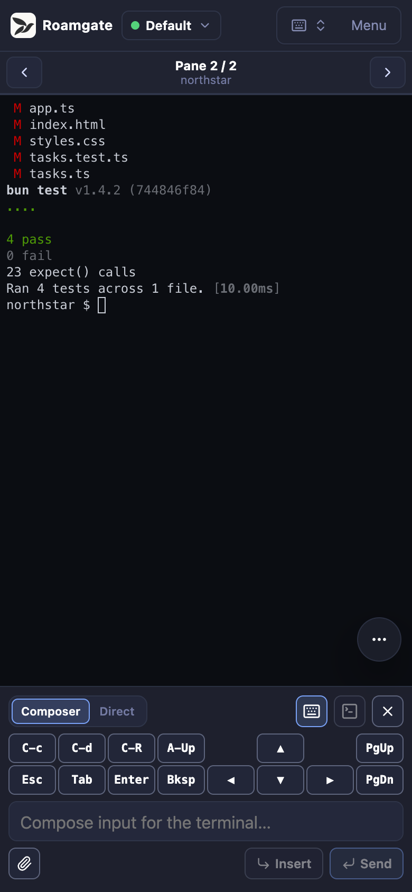

<!-- markdownlint-disable MD033 -->
<!-- Explicit anchors keep section links usable in both GitHub and Pages. -->

# From your first terminal to a workspace that travels

Practice one task: ask an agent to improve a README, review the change, then
check it from another device. Chapter 1 takes about 5 minutes, chapters 1–3
about 25, and remote access another 15–25. You can stop after any chapter.
**This website does not run Herdr or keep terminals alive.**

## 1. Start here: see your own work locally

<a id="start"></a>

```text
Browser / PWA -> Roamgate (HTTP + WebSocket) -> Herdr -> shell / agent
```

Herdr owns the terminals, Roamgate is the browser UI, and agents remain CLIs.
Roamgate does not provide models or install agents. Closing the browser leaves
terminals running; sleeping or shutting down the host stops them.

1. Start Herdr with a trusted project open ([herdr.dev](https://herdr.dev)), or
   run `roamgate herdr setup` after [installing Roamgate](./DEPLOYMENT.md#install-a-release).
2. Run `roamgate` (`roamgate.exe` on Windows) on the same computer and leave it
   running. Plugin users use the [start action](./DEPLOYMENT.md#herdr-plugin)
   and get the URL from the plugin panel.
3. Open the printed URL **on that computer** and log in with your password or the
   token from the file the bridge reports. Pick a workspace and an idle shell,
   then run `pwd` (`Get-Location` in PowerShell).

**You are done when:** the terminal shows your project directory.

Login is required even on `127.0.0.1:8787` (only the loopback development
server skips it); see [Security](../SECURITY.md#trust-model). Upgrading from Herdr Studio? Follow the
[migration guide](./DEPLOYMENT.md#transition-from-herdr-studio--herdr-gui)
first.



| Object | Meaning |
| --- | --- |
| Workspace | A working environment, usually a project directory |
| Tab | A layout within a workspace |
| Pane | One terminal in a tab |
| Worktree | A separate Git checkout directory and branch |

**Splitting panes does not isolate files.** Use worktrees for parallel edits.

## 2. Everyday work: verify what the agent changed

<a id="daily"></a>

### Give the agent one task

1. Select your project, create a tab, and split it right from the pane menu.
2. Start an installed, signed-in agent on the left; keep a shell on the right.
3. Paste this prompt, review it, and submit it yourself (model usage may cost
   money):

```text
Read this project's README and add a short first-run example.
Check the project's actual commands first; do not invent flags.
Modify only the README. Do not install dependencies, commit, or push.
When finished, explain what changed and what you have not actually verified.
```

Use the command menu to find workspaces, files, tabs, panes, and agents, and the
recent pane switcher to jump between panes. See
[shortcuts](../FEATURES.md#keyboard-shortcuts).

**You are done when:** you can find the agent's explanation in **Agent
History**. A `done` status does not mean checks passed. Missing history? See
[session inspection](../FEATURES.md#agent-awareness-and-session-inspection).

### Review the file and diff

1. Open **File Explorer**, select `README.md`, and switch between rendered and
   source views.
2. Open **Diff Viewer > Working tree** and read the changed lines.
3. Search (`Cmd/Ctrl+F`) for the new command and check it against the project.

**You are done when:** you can point to the change and confirm its command works.



Uploads, deletions, and SSH file operations change real files on the target host.

### Send precise feedback

1. Click or drag diff line numbers and add a comment, such as "Use the dev
   command in package.json."
2. Review it in **Annotations**, then pre-fill the agent pane's input.
3. Check the message in that pane and press Enter yourself.

**You are done when:** the agent receives your feedback with its context.
**Pre-fill never submits.** Drafts stay in this browser.



No commit is needed for this exercise. **Discard Unstaged loses changes and
Delete Untracked deletes files; confirmation is not a backup.**

## 3. Parallel work and mobile access

<a id="workflow"></a>

### Separate parallel edits with worktrees

1. Make sure `origin` is reachable. Review `roamgate.json` (or legacy
   `paseo.json`): its hooks are on by default and run on the host. Disable
   **Worktree hooks** if you do not trust them.
2. Open **Worktree Lifecycle** and create a worktree. It starts from `origin`'s
   latest default branch and does not copy uncommitted files.
3. Run `pwd` and `git status` there before starting another agent.

**You are done when:** parallel tasks use different directories and branches.
Save wanted results before removing a worktree; a
[failed teardown hook blocks removal](./DEPLOYMENT.md#worktree-hooks).

### Continue from your phone

Set up [Tailscale + Serve](#tailscale) first: `127.0.0.1` on a phone means the
phone itself.

1. Open Roamgate's HTTPS URL on your phone, log in, and select your pane.
2. Use the floating shortcuts for Ctrl and arrow keys, and open Changes to review
   the diff.
3. Adjust **Configuration > Appearance** scale or terminal font size if needed,
   then install the PWA:

| Browser | Install action |
| --- | --- |
| iPhone/iPad Safari | Share > Add to Home Screen |
| macOS Safari 17+ | File > Add to Dock |
| Chrome/Edge | Browser menu > Install app |

**You are done when:** the home-screen icon opens your project. Install your
Roamgate URL, not this tutorial site.



A PWA is not offline access: host sleep, a stopped service, or lost VPN
interrupts it. [Notifications](./DEPLOYMENT.md#web-push-notifications) are
best-effort. **Everyone you let in has full terminal and file access**, so do not
share the URL like a read-only link.

## 4. Remote access: choose the right connection

<a id="networking"></a>

| Goal | Route |
| --- | --- |
| Regular phone/computer access | [Tailscale + Serve](#tailscale) |
| Local Roamgate controlling a remote Herdr | [SSH profile](#ssh) (Linux/macOS bridge) |
| Another computer using a remote Roamgate | [SSH port forwarding](#ssh) |
| Temporary access between your own computers | [Tailcat](#tailcat) |

None of these need router port forwarding.

### Safety checks

- Admit only fully trusted people and devices.
- Login is still required behind any tunnel; keep the password or token private.
- Use HTTPS or an encrypted tunnel and restrict who can connect. See
  [Security](../SECURITY.md).
- Keep passwords, token URLs, and Tailcat addresses out of screenshots, issues,
  chats, and committed files.

<a id="tailscale"></a>

### Tailscale + Serve: regular private access

Tailscale connects your devices privately; Serve gives Roamgate an HTTPS address
reachable only inside your tailnet.

1. Install [Tailscale](https://tailscale.com/download) on both devices, join the
   same tailnet, and check `tailscale status`.
2. [Restrict access](https://tailscale.com/docs/features/access-control) to the
   intended users and devices on port 443.
3. On the Herdr host, run Roamgate on loopback:

   ```bash
   roamgate --host 127.0.0.1 --port 8787
   ```

   If a service already runs it, set `HOST=127.0.0.1` in its
   [environment file](./DEPLOYMENT.md#run-as-a-user-service) and run
   `roamgate service restart` instead of starting a second copy.

4. If `tailscale serve status` shows port 443 at `/` is free, run:

   ```bash
   tailscale serve --bg --https=443 http://127.0.0.1:8787
   ```

   Approve the HTTPS certificate prompt. Hostnames appear in public certificate
   logs, so avoid sensitive names.
5. On your phone (with Tailscale on), open the **printed HTTPS hostname**, log
   in, and run `pwd`. Confirm devices outside your access rules cannot connect.

**You are done when:** it works over cellular and excluded devices are denied.

**Serve is private; Funnel is public. Never use `funnel` here.** To stop
sharing:

```bash
tailscale serve --bg --https=443 off
tailscale serve status
```

Avoid `tailscale serve reset`, which clears all Serve settings. For daily use,
run Roamgate as a [user service](./DEPLOYMENT.md#run-as-a-user-service) on
loopback.

<a id="ssh"></a>

### SSH: remote Herdr or remote web interface

**Option A: local Roamgate, remote Herdr** (needs a Linux/macOS bridge; the
remote host can be Unix or Windows).

1. Make sure plain `ssh` works non-interactively, put keys, ports, and jump hosts
   in `~/.ssh/config` (for example alias `workbox`), and start Herdr remotely.
2. In Roamgate's connection selector, add an SSH profile with destination
   `workbox` and the remote OS. Leave Unix socket paths empty. For Windows, see
   [requirements](./DEPLOYMENT.md#multiple-and-remote-herdr-connections).
   Connect and run `pwd`.

Or start a dedicated bridge for that host:

```bash
roamgate --ssh-host workbox --host 127.0.0.1
```

Files, Git, uploads, and hooks then run on the remote host.

**Option B: forward a remote Roamgate's web port.** Both services stay remote;
this also works with Windows OpenSSH. On the visiting computer:

```bash
ssh -N -o ExitOnForwardFailure=yes -L 127.0.0.1:18787:127.0.0.1:8787 workbox
```

Open `http://127.0.0.1:18787` **on that computer** and log in with the remote
host's credential. Ctrl+C stops forwarding.

<a id="tailcat"></a>

### Tailcat: temporary access between trusted computers

[Tailcat](https://github.com/tailscale/tailcat#install) is an **experimental**
Tailscale tool that connects two computers without a tailnet account. It has no
access policies and this project has not verified it end to end. Use Tailscale
for phones.

1. Run Roamgate at `127.0.0.1:8787` on your work computer and check it locally.
2. In another terminal there, run:

   ```bash
   tailcat serve --key=new 8787
   ```

3. Privately send the printed `tc...` address to the visiting computer and run:

   ```bash
   tailcat forward tcREPLACE_WITH_PRIVATE_ADDRESS 18787:8787
   ```

   Keep it on `127.0.0.1`; never add `--bind=0.0.0.0`.
4. Open `http://127.0.0.1:18787`, log in, and run `pwd`.
5. Press Ctrl+C in both terminals and confirm the URL stops working.

**You are done when:** access works and ends when forwarding stops. Treat the
address as a secret: it contains a key. See Tailcat's
[security model](https://github.com/tailscale/tailcat/blob/main/SECURITY.md).

## 5. Troubleshoot the hop that failed

<a id="troubleshooting"></a>

Check in order:

1. On the Roamgate host, run `curl -fsS http://127.0.0.1:8787/healthz`
   (`curl.exe` in PowerShell). If refused, check the process, port, or service.
2. Open the page locally. If terminals fail, check Herdr, the selected
   connection, and the logs before touching the network.
3. Once local access works, check the route: `tailscale serve status`, the SSH
   forward, or both Tailcat processes.
4. If typing fails, check the selected pane and that your proxy supports
   WebSockets.

| Symptom | First check |
| --- | --- |
| Phone cannot reach `localhost` | Use Serve's HTTPS hostname. |
| Password set but no login page | Try a private window; an existing cookie or token URL may have logged you in. |
| Login returns `429` | Wait for `Retry-After`; clients behind one proxy share [login limits](../SECURITY.md#trust-model). |
| Address already in use | A service or plugin may already run Roamgate. |
| SSH history is empty | Check [session lookup limits](../FEATURES.md#agent-awareness-and-session-inspection). |
| Clipboard or PWA restricted | Use trusted HTTPS without certificate warnings. |

`roamgate doctor` checks most of this automatically. See
[Deployment](./DEPLOYMENT.md) for tokens, services, and debug logs. Never
disable authentication or open the firewall wide; share only redacted logs when
asking for help.

### Completion check

- [ ] I know which workspace, tab, and pane receives my input.
- [ ] I reviewed the actual diff; an agent's "done" is not verification.
- [ ] I know which host receives file and Git operations.
- [ ] For remote access, I know who can connect and how to stop sharing.

### References

[Features and shortcuts](../FEATURES.md) · [Deployment](./DEPLOYMENT.md) ·
[Security](../SECURITY.md) · [Architecture](./ARCHITECTURE.md) ·
[Tailscale Serve](https://tailscale.com/docs/features/tailscale-serve) ·
[Serve CLI](https://tailscale.com/docs/reference/tailscale-cli/serve) ·
[Tailcat](https://github.com/tailscale/tailcat#readme)

This Markdown is the canonical tutorial; the Pages build renders it to HTML.
